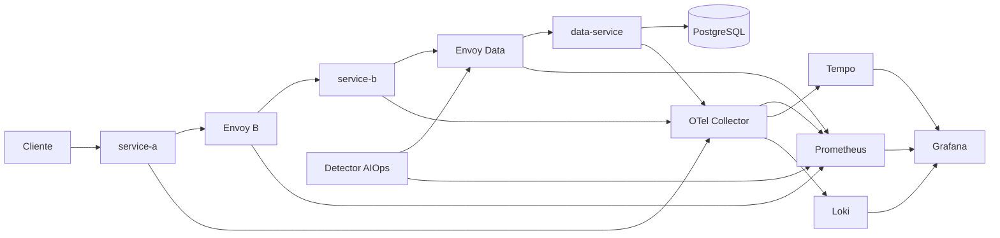

# Actividad 3.3 - Laboratorio integrador de observabilidad

**Estado: solución local ejecutada; requisitos cloud pendientes.** No se dispone de cuenta AWS.
No se afirma cumplimiento del 100%, despliegue en ambas nubes ni una nota garantizada.

Fuente: [Actividad 3.3 y rúbrica](https://unisabanae-learning.unisabana.edu.co/mod/assign/view.php?id=306421),
consultada mediante sesión autenticada el 18 de octubre de 2026.
La carpeta se llama `actividad 3` por indicación del usuario; la actividad del aula es la **3.3**.
El Game Day previo se conserva separado.

## Entregables

- `Reporte_Ejecutivo_Actividad_3.pdf`: informe ejecutivo de **10 páginas**, resultados,
  arquitectura, madurez de ocho dominios, roadmap de tres meses y limitaciones.
- `Video_Demostracion_Local.mp4`: captura real del navegador durante el laboratorio,
  sin audio; no sustituye la sustentación grupal ni una demostración en ambas clouds.
- `evidencias/`: datos crudos, trazas, logs, métricas, alertas, capturas, verificaciones e IaC validada.
- `src/`, `config/`, `scripts/`, `tests/`, `compose.yaml`: implementación reproducible.
- `iac/aws/`, `iac/gcp/`: base de infraestructura validada con Terraform, **no aplicada**.
- `docs/CLOUD_HANDOFF.md`: pasos concretos para completar los requisitos de nube.

## Matriz de cumplimiento de la rúbrica

| Criterio (máximo) | Demostrado | Brecha para nivel excelente |
|---|---|---|
| Arquitectura observable (1.25) | Tres servicios con OTel de los tres pilares, PostgreSQL y proxies Envoy L7; una traza completa A/B/data/DB | Ejecutar en GCP y AWS, conectar Cloud SQL/RDS y demostrar service mesh gestionado |
| AIOps (1.00) | Detector continuo, baseline + 2 sigma AND p99 > SLO; alerta con trace_id y comparación de ruido | Configurar y demostrar producto nativo de anomalías; ampliar evaluación estadística |
| Red y seguridad (1.00) | Métricas/logs Envoy, diez 401 y alerta, dashboard, escaneo de dependencias con hallazgos visibles | Flow Logs, SCC/Security Hub y fuentes/alertas operativas en ambas clouds |
| Caos y MTTD (1.00) | Dos fallos ejecutados, detección automática <120 s, SLI/budget y rollback verificables | Repetir y documentar las ejecuciones en los entornos cloud exigidos |
| Madurez y presentación (0.75) | Ocho dominios 1-5, roadmap y video local | Integrantes y sustentación grupal en vivo; demostración multicloud |

**No se calcula una calificación estimada.** La rúbrica no garantiza que el sandbox local
reciba las categorías intermedias que exigen una cloud. La docente evalúa las evidencias.

## Arquitectura ejecutada



`service.name` separa los tres procesos y `cloud.provider=local` identifica el entorno
real. El traceparent W3C atraviesa clientes HTTP instrumentados y los proxies.
OTLP HTTP lleva los tres pilares al Collector; las métricas se exportan a Prometheus,
las trazas a Tempo y los logs a Loki. Los logs incluyen trace_id, que nunca se usa como
etiqueta Prometheus. SQL usa spans reales y convenciones `db.system.name`,
`db.namespace`, `db.operation.name`, `db.query.summary` y `server.address`.

## Reproducir desde una copia limpia

Requisitos: Docker Engine/Desktop con Compose v2 y Python 3.11+.
Reservar aproximadamente 4 GB para el stack y comprobar que los puertos estén libres.

```powershell
cd 'actividad 3'
python scripts/init_env.py
python scripts/build_config.py
docker compose config --quiet
docker compose up -d --build
python scripts/experiment.py
python scripts/verify.py
```

El ensayo tarda unos 5 minutos y espera automáticamente las 12 ventanas de baseline.
La primera construcción requiere Internet para las imágenes y dependencias oficiales.
`experiment.py` consulta alertas reales en estado firing; no inventa eventos de detección.
Falla si había una alerta activa antes del ensayo, si no detecta ambos fallos <120 s o
si la recuperación conserva errores. Los fallos están limitados por TTL y se retiran en finally.
Antes de repetir, esperar que todas las alertas de caos estén inactivas. Para una nueva
línea base limpia, recrear únicamente Collector, detector y Prometheus de este proyecto;
no mezclar ensayos distintos en la misma carpeta de evidencias.

| Interfaz | Dirección local |
|---|---|
| Grafana, lectura anónima local | http://127.0.0.1:23000/d/actividad3-integrador |
| Prometheus / alertas | http://127.0.0.1:19090/alerts |
| Servicio de entrada | http://127.0.0.1:18080/work |
| Detector / estado y alertas | http://127.0.0.1:18083/state y /alerts |
| Tempo API | http://127.0.0.1:13200 |
| Loki API | http://127.0.0.1:13100 |

Las credenciales administrativas se generan aleatoriamente en `.env`, ignorado por Git.
No se necesitan para consultar Grafana como lector. El token de control es distinto
de las credenciales de demostración del endpoint `/auth`.

## Pruebas y seguridad

```powershell
docker run --rm --network none -v "${PWD}/tests:/lab/tests:ro" actividad3-observabilidad:local python -m unittest discover -s tests -v
docker compose exec -T prometheus promtool check rules /etc/prometheus/rules.yaml
docker compose exec -T collector /otelcol-contrib validate --config=/etc/otel.yaml
```

Las pruebas cubren la regla AND, sus límites estrictos y sigma cero. La verificación
de evidencias comprueba tres servicios/DB en la traza, persistencia de logs y métricas,
alertas firing, reducción de ruido y acceso al control protegido.
El archivo `security-scan.json` contiene hallazgos reales de pip-audit sobre las
dependencias instaladas. Los IDs duplicados se deduplican para el conteo del dashboard.
No se afirma ausencia de CVEs ni se confunde el escaneo Python con el de imágenes.
La validación de seguridad usó dos ráfagas de diez 401: la primera creó la serie del
contador y la segunda verificó `increase()` contra muestras previas. El script de
experimentos incorpora un probe inicial para evitar ese problema en nuevas ejecuciones.
Los veinte intentos y la alerta firing quedan registrados en `security-validation.json`.

Los binarios e imágenes se fijan por versión. `dependencies.txt` conserva el inventario
exacto resuelto en el ensayo; para endurecer producción deben generarse locks con hashes,
actualizar los hallazgos y fijar imágenes por digest con un análisis completo.
Los puertos quedan en loopback; la red se separa de otros proyectos Docker; los controles
de caos exigen token y TTL. Solo el inicializador de permisos de volúmenes usa root y no tiene red.

## Evaluar el resultado

- `results.json`: muestras por fase, tasa de errores, p99, SLI, consumo del budget y MTTD.
- `requests.csv`: cada petición de cliente con tiempo, estado y trace_id.
- `aiops-state.json`: baseline congelado, ventanas de probes y alertas enriquecidas.
- `events.json`: línea temporal UTC; equivale a UTC-5 para Colombia.
- `trace-success.json`: una misma traza de los tres servicios y consulta PostgreSQL.
- `verification.json`: comprobaciones automáticas, sin reemplazar el juicio de la rúbrica.
- `MANIFEST.sha256`: integridad de las evidencias finales; excluye el propio manifiesto.

El control de ruido inyecta 10% de errores rápidos. El segundo fallo añade 250 ms
a las solicitudes erróneas para satisfacer ambas señales. Esto se declara como parte
del diseño experimental: una regla AND no detecta necesariamente errores sin latencia.
SLO del ensayo: 99% de respuestas exitosas y <=200 ms. El budget se calcula por fase,
no por mes; las ventanas pequeñas no prueban una disponibilidad productiva mensual.

## Informe y video

Para regenerar el PDF: instalar `reportlab`, `matplotlib`, `pymupdf` y `Pillow`, disponer
de Arial en Windows y ejecutar `python scripts/report.py`. Las fuentes del informe
permanecen editables y las figuras se calculan desde los CSV originales.
El video se compone de capturas consecutivas reales con sus tiempos y subtítulos;
`scripts/video.py` permite reproducir el ensamblaje si se conservan los frames locales.
Por tamaño, los frames intermedios no forman parte de Git. El MP4 final sí se incluye.

## Cloud y cierre

Consultar `docs/CLOUD_HANDOFF.md`. Terraform no sustituye `plan`, permisos, apply ni
pruebas en nube. AWS App Mesh terminó soporte el 30/09/2026 según
[AWS](https://docs.aws.amazon.com/app-mesh/latest/userguide/); acordar la sustitución con la docente.
No se crean cuentas ni se incurren en costos cloud en esta entrega.

Para detener únicamente este laboratorio, ejecutar `docker compose down` desde esta
carpeta. Conserva los volúmenes de datos; no usar borrado de volúmenes sin respaldar.
El tag `v1.0` identifica esta versión local con brechas cloud declaradas; no certifica
cumplimiento íntegro de la actividad.
